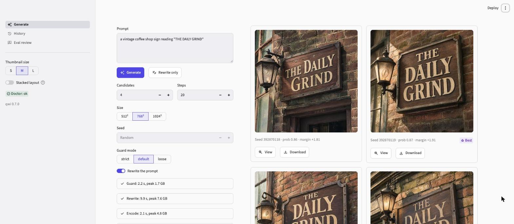
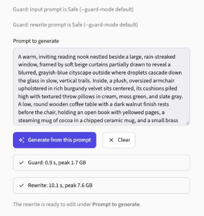
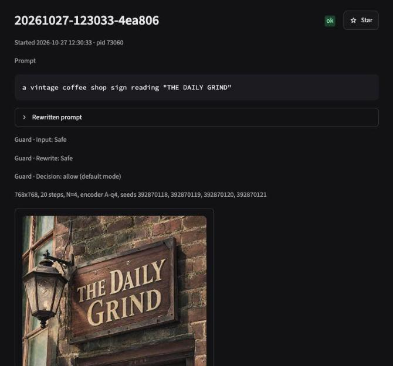

# qwi

Local text-to-image pipeline for Apple Silicon: Qwen-Image-2.1 on MLX with a Qwen3 safety guard, prompt rewriting and best-of-N reranking. CLI + Streamlit UI.

<picture>
  <source media="(prefers-color-scheme: dark)" srcset="docs/screenshots/generate-dark.png">
  
</picture>

Each run has four stages, with one model in memory at a time:

1. **Guard.** Qwen3Guard checks the prompt, and later the rewrite. *Unsafe* prompts are blocked; `--guard-mode` sets how *Controversial* ones are handled.
2. **Rewrite.** Qwen3-VL-8B expands a short prompt into a detailed image description. Skip it with `--no-rewrite`, or rewrite first and edit the result.
3. **Generate.** Qwen-Image-2.1 (4-bit, through [mflux](https://github.com/filipstrand/mflux)) draws N candidates, one seed each.
4. **Rerank.** Qwen3-VL-Reranker scores each candidate against *your* prompt, marks the best, and warns when none clearly matches.

Once the models are downloaded, everything runs offline. Nothing leaves your Mac.

## Requirements

- **Mac with Apple Silicon and about 32 GB of memory.** Developed on an M2 Max (32 GB). The largest stage peaks at about 14 GB, and a check before each stage stops a run that won't fit.
- **About 20 GB of disk for the models, plus 20 GB kept free.** qwi refuses any download that would leave less than 20 GB. Each default run adds 3–4 MB.
- **[uv](https://docs.astral.sh/uv/).** It installs Python 3.12 for you.

A default run (4 candidates, 768², 20 steps) takes about **8½ minutes** on the M2 Max: about 2 minutes per image, and seconds for the other stages.

## Install

```bash
git clone https://github.com/darylalim/qwi.git
cd qwi
uv sync --all-extras    # the CLI plus Streamlit for the UI
uv run qwi doctor       # checks disk, models, storage and offline mode
```

`doctor` lists the missing models until you fetch them.

## Models

`qwi models fetch` is the only command that downloads anything. It fetches a role's weights from Hugging Face at the revision pinned in `models.toml`, after checking that 20 GB will stay free:

```bash
uv run qwi models fetch image --dry-run   # show size and free disk; download nothing
uv run qwi models fetch guard
uv run qwi models fetch rewrite
uv run qwi models fetch rerank
uv run qwi models fetch image
uv run qwi models fetch ocr               # optional: used only by the eval's text check
```

| Role | Size on disk |
|---|---|
| guard | 1.1 GiB |
| rewrite | 5.4 GiB |
| rerank | 2.5 GiB |
| image | 8.9 GiB |
| ocr (eval only) | 2.5 GiB |

Weights go to the standard Hugging Face cache (`~/.cache/huggingface`). Runs load them with `HF_HUB_OFFLINE=1` and never download.

### Model licenses

This repository contains no model weights. Models are downloaded separately and keep their own licenses. The table is generated from `models.toml` (`tests/test_licenses.py` keeps it in sync):

| Role | Model | Revision | License |
|---|---|---|---|
| guard | [`mlx-community/Qwen3Guard-Gen-0.6B-MLX`](https://huggingface.co/mlx-community/Qwen3Guard-Gen-0.6B-MLX) | `919a4577` | [Apache License 2.0](https://www.apache.org/licenses/LICENSE-2.0) |
| rewrite | [`mlx-community/Qwen3-VL-8B-Instruct-4bit`](https://huggingface.co/mlx-community/Qwen3-VL-8B-Instruct-4bit) | `defcdea7` | [Apache License 2.0](https://www.apache.org/licenses/LICENSE-2.0) |
| rerank | [`mlx-community/Qwen3-VL-Reranker-2B-8bit`](https://huggingface.co/mlx-community/Qwen3-VL-Reranker-2B-8bit) | `e9cd8bbe` | [Apache License 2.0](https://www.apache.org/licenses/LICENSE-2.0) |
| ocr | [`mlx-community/Qwen3-VL-2B-Instruct-8bit`](https://huggingface.co/mlx-community/Qwen3-VL-2B-Instruct-8bit) | `b0338e0e` | [Apache License 2.0](https://www.apache.org/licenses/LICENSE-2.0) |
| image | [`mlx-community/Qwen-Image-2.1-mflux-q4`](https://huggingface.co/mlx-community/Qwen-Image-2.1-mflux-q4) | `746a5855` | [Qwen Research License (research and non-commercial use)](https://huggingface.co/Qwen/Qwen-Image-2.1) |

**Qwen-Image-2.1 is under the Qwen Research License (research and non-commercial use), and so are the images you generate with it.** Repacks such as `mlx-community/Qwen-Image-2.1-mflux-q4` (the `image` row) are treated as Qwen Research License too, whatever their model card says.

## Usage

Commands below are shown as `qwi …`; from the repo, run them as `uv run qwi …`. Every command has `--help`.

### UI

```bash
uv run qwi ui    # http://localhost:8501
```

- **Generate.** Prompt and settings on the left; candidates appear on the right as they finish. **Cancel** stops after the current step and keeps the finished images. **Rewrite only** puts the rewrite in an editable box; **Generate from this prompt** uses your edit but still ranks against your original prompt. Each card has **View** and **Download**.
- **History.** Every run, newest first, with its images, prompts, guard verdicts, timings and log. Star a run to protect it from `qwi runs prune`. Each run has its own link (`?run=<id>`).
- **Eval review.** Blind side-by-side judging for the [eval workflow](#eval-workflow).

<p>
  
  
</p>

The sidebar's **Thumbnail size** (S / M / L) and **Stacked layout** (one column, for half-screen windows) are saved in the URL, so a bookmark keeps them. The theme follows your system; change it in the ⋮ menu. Only one run happens at a time, across the UI and the CLI.

### CLI

```bash
uv run qwi generate "a vintage coffee shop sign reading \"THE DAILY GRIND\"" -n 4
uv run qwi generate "a red apple" --no-rewrite --seed 42 --steps 30
uv run qwi rewrite "a cozy reading nook"               # print the rewrite, then edit it:
uv run qwi generate "<edited rewrite>" --no-rewrite
uv run qwi generate --continue-seeds <run-id> -n 4     # 4 more seeds for the same prompt
```

Each run writes its images and a `run.json` to `$QWI_HOME/runs/<run-id>/` (`$QWI_HOME` defaults to `var/` in the repo). `best.png` links to the top-ranked candidate.

| Command | What it does |
|---|---|
| `qwi generate "<prompt>"` | Full run: guard, rewrite, generate, rerank (options below) |
| `qwi rewrite "<prompt>"` | Guard and rewrite only, then print the result (`--guard-mode`, `--rewrite-style`) |
| `qwi ui` | Start the Streamlit UI (`--port`, default 8501) |
| `qwi doctor` | Read-only health check |
| `qwi models fetch <role>` | Download a role's pinned weights (`--dry-run`) |
| `qwi runs list` | List runs, newest first: id, date, status, star, size, prompt |
| `qwi runs show <id>` | Show one run's summary; an id prefix works (`--log`, `--level`, default info) |
| `qwi runs star <id>` | Toggle a run's star; `prune` never deletes starred runs |
| `qwi runs prune` | Delete old runs (`--keep-days N` or `--keep-last N`; `--eval` for eval images; `--dry-run`) |
| `qwi eval …` | The [eval workflow](#eval-workflow) |
| `qwi --version` | Print the installed version |

`qwi generate` options:

| Option | Default | What it does |
|---|---|---|
| `-n` | 4 | Number of candidates (one seed each) |
| `--steps` | 20 | Denoising steps |
| `--width`, `--height` | 768 | Image size in pixels |
| `--seed` | random | Base seed |
| `--guard-mode` | default | `strict`, `default` or `loose`: how *Controversial* prompts are handled. *Unsafe* always blocks. |
| `--no-rewrite` | off | Generate from the prompt as written |
| `--rewrite-style` | long | `short` (40–120 words) or `long` (400–500 words) |
| `--show-rewrite` | off | Print the rewrite before generating |
| `--min-score` | 0.5 | Warn when the best candidate scores below this |
| `--continue-seeds <run-id>` | — | N more seeds after that run's last one, with its prompt, size and steps |
| `--allow-swap` | off | Let a stage use up to 6 GiB of swap before it's stopped (otherwise 2 GiB) |
| `-v` | off | Debug logs |

## Troubleshooting

Start here:

```bash
uv run qwi doctor                  # disk, models, $QWI_HOME, offline mode, torch
uv run qwi runs show <id> --log    # what a run did, step by step, with any traceback
```

A failed run keeps the candidates it finished, and every failure frees model memory and the run lock. qwi never retries on its own.

| Message | Exit code | What to do |
|---|---|---|
| Blocked by guard | 2 | The prompt or its rewrite was judged unsafe. Rephrase it. `--guard-mode loose` relaxes only *Controversial* verdicts, never *Unsafe*. |
| Another run is in progress | 3 | Wait for it, or cancel it in the UI. |
| Not enough free memory for *stage* | 4 | Close other apps, or try 512² or fewer candidates. The UI offers one-click retries. |
| Ran out of GPU memory during *stage* | 4 | Same as above. Finished candidates are kept, unranked. |
| *role* model not available | 5 | Run `uv run qwi models fetch <role>`. |
| Disk full / Not enough disk | 6 | Free space with `uv run qwi runs prune --keep-last 20` (try `--dry-run` first), or remove unused models with `hf cache`. |
| Cancelled after *n* of *N* candidates | 130 | Nothing to do. Finished candidates are kept. |
| Unexpected error | 1 | Read the traceback with `uv run qwi runs show <id> --log`. |

If macOS starts swapping, a watchdog stops the stage after 2 GiB of swap (6 GiB with `--allow-swap`).

## Development

```bash
uv sync --all-extras
uv run ruff format && uv run ruff check --fix
# All gates (CI runs the same):
uv run ruff format --check && uv run ruff check && uv run ty check && uv run pytest
```

- **Fast tests:** `uv run pytest` uses a fake pipeline and needs no models.
- **Slow tests:** `uv run pytest -m slow` loads the real models (download them first) and takes several minutes.
- **UI without models:** `QWI_PIPELINE=fake QWI_HOME=/tmp/qwi uv run qwi ui`.
- **Dependencies:** add or remove them with `uv add` / `uv remove` only. `mflux` is pinned exactly.
- **No torch:** mflux declares it, but a `[tool.uv]` override keeps it out, and the tests check that the runtime never imports it.

[`PLAN.md`](PLAN.md) holds the design, decisions and measurements; [`CLAUDE.md`](CLAUDE.md) has the working rules.

### Eval workflow

Changes that can affect image quality (the mflux version, a model revision, the rewriter prompt, the reranker, the guard policy) are judged blind on a fixed set of 12 prompts (`eval/prompts.jsonl`) before they merge:

```bash
uv run qwi eval --variant baseline       # on main → eval/results/<date>_baseline
uv run qwi eval --variant my-change      # on the branch → eval/results/<date>_my-change
uv run qwi eval session --a <date>_baseline --b <date>_my-change   # blind pairs, sides shuffled
uv run qwi eval review <session>         # judge in the browser (port 8502)
uv run qwi eval compare <session>        # unblind and score; writes report.md
```

`qwi eval session` prints the session name; sessions live in `eval/sessions/`. Results and sessions are committed; images stay in `$QWI_HOME/eval`. CI fails a PR that touches one of these files without an `Eval:` line in its description.

## License

The code is licensed under the [Apache License 2.0](LICENSE); see [NOTICE](NOTICE). This license doesn't cover model weights or the images generated with them.
